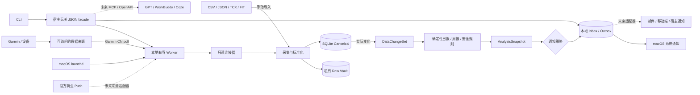

# 产品技术架构

## 1. 当前架构结论

当前产品是本地优先的 Python 模块化单体。领域规则与确定性分析不依赖 Garmin、AI Provider、SQLite 或模型宿主；端口和适配器负责连接这些外部能力。

已经落地的自动路径是：Garmin 中国区本地会话只读轮询 → 原始证据与标准记录 → 真实变化集 → 确定性日报/周报及安全规则 → 本地 Inbox → macOS Notification Center。macOS `launchd` 可在用户登录会话中周期性唤起一次有界 Worker。

已落地只读 stdio MCP 传输。尚未落地的路径包括官方 Garmin 商业 Push/OAuth、ChatGPT 网页插件与 Tunnel 端到端接入、WorkBuddy/Coze 适配、HTTP/OpenAPI、邮件/移动端通知、Windows/Linux 服务安装器以及托管多用户 Worker。图中虚线均表示这些未来适配器。

## 2. 系统关系



设备上传到 Garmin Connect 和本地产品读取是两个步骤；产品的同步时效从数据已经进入可访问来源后开始计算。本地 Worker 只在 Mac 开机、用户已登录且进程能访问网络时工作，恢复后按策略回看窗口补拉。

## 3. 分层与依赖方向

```text
interfaces/cli ─┐
interfaces/host ├──> application ───> domain
adapters        ┘         │             ▲
                          └──> ports <───┘
```

- `domain/`：运动员、标准记录、目标、训练、恢复、营养、赛事、分析和安全规则；不导入基础设施。
- `application/`：采集、报告、计划、恢复、营养、赛事、AI 路由和自动闭环用例。
- `ports/`：数据源、Repository、通知、模型 Provider 与受确认保护的训练写回契约。
- `adapters/`：Garmin 中国区、文件、SQLite、原始保险库、AI Provider、macOS 通知和 `launchd`。
- `interfaces/cli/`：当前用户和运维入口。
- `interfaces/host/`：返回 JSON 安全结果的宿主无关函数 facade；当前自动化 CLI 复用它。它不是已经完成的 MCP、HTTP 或某个模型宿主插件。
- `interfaces/mcp/`：把现有应用层只读命令暴露为本地 stdio MCP；不包含凭据或远程身份管理。

未来 GPT、WorkBuddy 和 Coze 适配器必须调用同一个 facade/应用用例，不复制训练算法、安全规则或持久化状态。

## 4. 自动闭环的持久化实体

| 实体 | 当前职责 | 关键身份或状态 |
|---|---|---|
| `SyncSubscription` | 一个运动员、一个来源的轮询策略 | 来源、间隔、回看天数、通知模式、本地摘要小时、启用状态 |
| `SyncRun` | 一次到期、强制或恢复运行 | 稳定请求键、运行状态、所有者、租约 Token、到期时间 |
| `DataChangeSet` | 本批真正新增、替换或失效的记录 | 运行 ID、变化记录、受影响日期、冻结投影记录 ID |
| `AnalysisSnapshot` | 对冻结投影生成的不可变报告 | 变化集、周期、分析类型、算法版本、风险、冻结 JSON |
| `UserNotification` | Inbox 与外部投递状态 | 快照、策略版本、渠道、已读/已投递、尝试次数、下次尝试、投递租约 |

这些实体与标准记录保存在同一个 Profile SQLite 数据库中，因此运行状态不会依赖内存队列、模型对话或 `launchd` 进程是否一直存活。

## 5. 领取、租约与 fencing

自动运行采用至少一次处理，而不是声称无法验证的“恰好一次”。可靠性由原子领取、租约 fencing 和幂等副作用共同提供：

1. Worker 用 SQLite `BEGIN IMMEDIATE` 原子领取到期策略；同一来源存在运行中任务时不会并发领取第二个。
2. 领取生成所有者、随机租约 Token 和到期时间。长任务在接近到期时续租。
3. 写入标准记录、游标和变化集时使用 lease-fenced 事务；过期或已被接管的 Worker 不能提交。
4. 生成快照、通知和完成运行前再次校验同一租约。旧 Worker 的迟到写入会被拒绝。
5. 崩溃后，下一 Worker 可回收已过期的运行租约；若变化集或部分快照已经存在，则从持久化交接点继续，而不是重新制造副作用。

同步失败只影响本次运行；已有标准记录不被删除，下一配置间隔可再次轮询。通知投递另有独立短租约，避免多个 Worker 同时发送同一条消息。

## 6. 幂等身份与不可变投影

- 计划运行的请求键由运动员、来源和计划时间槽确定；`--force` 使用运动员、来源和当前分钟槽，因此同一分钟重试不会创建第二个强制请求。
- `DataChangeSet` 每个 `SyncRun` 最多一个；纯重复批次不创建变化集。
- `AnalysisSnapshot` 由变化集、报告周期、分析类型和算法版本唯一确定。
- `UserNotification` 由快照、通知策略版本和渠道唯一确定。
- 已存在对象再次写入时必须内容一致，否则报告幂等冲突，不会静默覆盖。

`DataChangeSet.projection_record_ids` 冻结变化发生时的“当前记录”集合。恢复或重算使用该投影，而不是读取后来已经变化的当前视图。`AnalysisSnapshot` 的报告 JSON 在模型层复制并冻结；算法升级产生新身份，不修改旧结论。

标准记录本身也保留版本链：更正记录通过 `supersedes_id` 指向旧版本，旧记录退出当前投影但仍作为历史存在。

## 7. 原始证据与事务边界

原始来源载荷按内容 SHA-256 存在 Profile 自己的 `raw/<source>/<hash-prefix>/<hash>.json` 下。标准记录的 Evidence 引用来源和哈希。

自动采集先在 Profile Raw 根目录下的隐藏 staging 目录准备文件，再在受租约保护的数据库事务中写入标准记录、游标和变化集。进入分析或崩溃恢复前，系统会：

- 验证变化记录及冻结投影所引用的原始对象存在；
- 重新计算文件哈希并与 Evidence 一致；
- 要求路径严格位于该运动员 Raw 根目录内；
- 在支持的平台使用目录文件描述符和 `O_NOFOLLOW`，拒绝符号链接逃逸。

原始证据缺失、被篡改或路径越界时，恢复会失败并留下可见运行状态，而不是基于不可验证输入继续分析。

## 8. 分析与通知

每个非空变化集按受影响日期生成确定性日报，并为最新受影响日期生成一份 7 天周报。分析使用 `ReportService` 和安全规则，不调用 AI 也能完成；AI Provider 仅用于用户显式请求的可选解释。

通知策略的当前行为：

- `actionable-digest`：中/高风险立即可投递，低/未知风险排到个人资料时区的下一指定小时；
- `all`：每个真实变化集立即创建一条通知；
- `off`：仍创建分析快照；新分析不创建通知。已有 Inbox/历史和待投递项保留，但当前来源为 `off` 时投递领取与发送会被抑制；重新启用后仍待投递的到期项可恢复投递。

投递 Worker 原子领取一条到期消息，并在调用外部 Sink 前续租。失败后按指数退避重新排期，最长一小时。成功使用 `delivered_at` 作为回执。系统提供至少一次外部投递：若 macOS 接受通知后进程在保存回执前崩溃，可能出现一次罕见重复；Inbox 和快照仍保持单一幂等身份。

## 9. 平台适配器

| 边界 | 当前实现 | 待实现 |
|---|---|---|
| 数据来源 | Garmin CN 本地认证会话只读 Poll；CSV/JSON/TCX/FIT 文件 | 官方 Garmin 商业 OAuth/Push、更多设备 |
| 调度 | macOS 用户级 `launchd` | Windows Task Scheduler、Linux systemd、容器/托管调度 |
| 通知 | 本地 Inbox、macOS Notification Center | 邮件、移动推送、GPT/WorkBuddy/Coze 主动通知 |
| 用户入口 | CLI、宿主无关 Python facade | MCP、Plugin、HTTP/OpenAPI、Web/App |
| AI | Provider 端口与显式、可降级解释 | 托管模型编排与宿主级授权体验 |

Garmin 中国区适配器使用本地缓存会话和非官方 Garmin Connect 接口，不是官方商业集成。它声明 `read_only=True`、`supports_write=False` 和 `delivery_mode="poll"`。

## 10. 数据与研发边界

产品仓包含可构建的源码、SQLite Schema、迁移逻辑、合成 Fixture、测试和公开技术文档。这些资产可以独立构建和验证；当前项目许可证仍是 `Proprietary`，因此不能把“可开源边界”误写为已经开源。

真实运行数据位于被 Git 忽略的保险库中：

```text
~/.athlete-growth/
├── config.toml
├── tokens/
├── profiles/<athlete-id>/
│   ├── raw/
│   ├── db/athlete.sqlite3
│   ├── derived/
│   ├── reports/
│   └── backups/
├── exports/
└── logs/
```

数据库、原始数据、Token、日志、导出和备份不进入产品 Git。定价、销售、Sprint、会议和私有调研属于独立的产品研发/运营过程；产品构建与运行不得依赖这些材料。未来开源时发布代码与 Schema，不发布任何个人保险库内容。

## 11. 安全和产品边界

- Garmin 密码和 MFA 只用于本机交互式登录，不进入普通命令参数；会话 Token 不交给 AI 宿主。
- `automation-status` 返回策略、运行、积压和最近分析的安全视图，不返回凭据、租约、原始载荷或本地路径。
- 删除、远程写回等敏感动作需要显式确认；当前自动循环只读 Garmin。
- 缺失主观 Check-in 不能被解释为“状态良好”。
- 确定性安全规则优先于 AI，AI 不得绕过规则。
- 产品不提供医疗诊断、治疗、处方、实时生命体征监控或紧急响应。

## 12. 验证策略

- 单元测试：领域模型、确定性分析、安全规则、通知摘要时区与 macOS 调度器。
- 契约测试：Garmin CN 只读边界和 AI Provider。
- 集成测试：SQLite 迁移、原子领取、并发 Worker、租约续期/接管、fencing、崩溃恢复、原始证据校验、投递重试与 CLI。
- 静态检查：Ruff、Pyright、`compileall`。
- 真实环境验收：由用户另行验证 Garmin 登录、网络、macOS 通知权限、`launchd` 安装和长期运行；仓库测试不能替代这些步骤。
