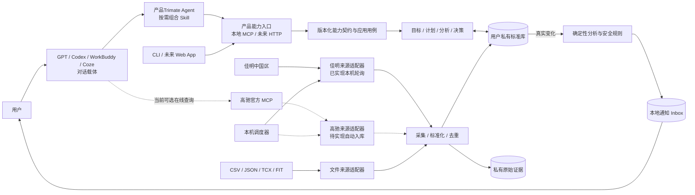

# 产品技术架构

白板风格详图见[AI Trimate架构流程图](training-partner-whiteboard.md)；跨领域复用版本见[可复用的 Agent 产品架构蓝图](reusable-agent-product-architecture.md)。

## 1. 当前架构结论

当前产品是本地优先的 Python 模块化单体。领域规则与确定性分析不依赖 Garmin、AI Provider、SQLite 或模型宿主；端口和适配器负责连接这些外部能力。Trimate Agent 是项目常驻的产品对话入口，产品 Skill 是按需调用的训练方法；它们是产品自有、可版本化的资产，面向不同模型宿主交付。用户数据、目标和计划等业务状态仍由产品内核及私有库管理。

GPT/Codex、WorkBuddy、Coze 是平行的对话载体，负责承载Trimate并调用同一产品能力契约。佳明、高驰是平行的设备数据来源，归产品的数据连接层管理。载体不拥有设备连接规则，也不保存设备账号凭据；来源适配器负责各设备的授权、拉取和标准化。佳明中国区已接入本机私有库和自动轮询；高驰增加了独立于载体的试验性本机轮询适配器，真实账号返回格式与授权链路尚需验收。详见[设备连接能力](device-connections.md)。

训练喜好作为用户私有状态保存：结构化偏好先预览再确认，保留历史版本，并在成长画像中展示；新计划只在本次输入未覆盖时读取已确认偏好。Skill 描述询问和使用偏好的方法，不保存个人喜好。自由文本偏好笔记不会自动驱动排课。详见 [ADR 0013](adr/0013-private-training-preferences.md)。

已经落地的自动路径是：Garmin 中国区本地会话只读轮询 → 原始证据与标准记录 → 真实变化集 → 确定性日报/周报及安全规则 → 本地 Inbox → macOS Notification Center。macOS `launchd` 可在用户登录会话中周期性唤起一次有界 Worker。

已落地本地 stdio MCP 传输和版本化能力目录。适合对话调用的阶段 0–5 能力现在按只读、纯计算预览、受确认保护的写入及本机管理四类映射；MCP 覆盖档案/引导、数据质量、活动、报告、目标/计划、Check-in、恢复、补给、赛事、成长决策和通知。目标计划支持多周重点轮换预测与逐周七天计划预览；尚未落地的路径包括完整目标可行性评估与自动渐进的专项周期处方、独立真人确认通道、官方 Garmin 商业 Push/OAuth、ChatGPT 网页插件与 Tunnel 端到端接入、WorkBuddy/Coze 适配、HTTP/OpenAPI、邮件/移动端通知、Windows/Linux 服务安装器以及托管多用户 Worker。图中虚线均表示这些未来适配器。

## 2. 系统关系



设备上传到 Garmin Connect 和本地产品读取是两个步骤；产品的同步时效从数据已经进入可访问来源后开始计算。本地 Worker 只在 Mac 开机、用户已登录且进程能访问网络时工作，恢复后按策略回看窗口补拉。

## 3. 分层与依赖方向

```text
interfaces/cli ─┐
interfaces/host ├──> application ───> domain
adapters        ┘         │             ▲
                          └──> ports <───┘
```

- `domain/`：运动员、标准记录、目标、训练、恢复、营养、赛事、分析和安全规则；不导入基础设施。
- `application/`：采集、报告、计划、恢复、营养、赛事、AI 路由和自动闭环用例。
- `ports/`：数据源、Repository、通知、模型 Provider 与受确认保护的训练写回契约。
- `adapters/`：当前包含 Garmin 中国区、文件、SQLite、原始保险库、AI Provider、macOS 通知和 `launchd`；高驰自动入库适配器待实现。
- `interfaces/cli/`：当前用户和运维入口。
- `interfaces/host/`：版本化能力目录和宿主无关 facade，组合已实现应用用例并返回有界、JSON 安全的结果；自动化 CLI 也复用其中部分函数。
- `interfaces/mcp/`：本地 stdio 传输、工具输入契约和安全分级；只接受允许的字段，不接受数据目录、任意文件路径或凭据，不含远程身份管理。

GPT/Codex、WorkBuddy 和 Coze 适配器应调用同一个 facade/应用用例，不复制训练算法、安全规则、设备连接逻辑或持久化状态。高驰官方 MCP 的宿主直接连接仅是当前在线查询路径，不构成产品私有库同步；未来高驰来源适配器应与佳明适配器同层，供所有载体使用。

目标使用形态中，用户始终从Trimate Agent 发起请求。Agent 先识别意图，再按需组合产品 Skill；Skill 规定训练场景的方法、追问、工具编排、证据解释、缺口处理与输出验收。宿主适配将常驻 Agent 与场景方法转换为各平台支持的指令、Skill、Workflow 或 UI。Agent/Skill 与版本化工具契约共同构成产品对话能力，不以某个宿主的 Prompt 为唯一源码。目标共创、计划预览、用户确认、版本保存与复盘属于应用用例，领域层负责可行性和安全约束，个人资料与计划状态保存在用户私有库中。未来 Web/App 可复用应用用例，不依赖对话宿主。具体决策见 [ADR 0012](adr/0012-always-on-training-partner-entry.md)。

Agent/Skill 产品资产应有稳定 ID、版本、适用场景、所需能力、输入缺口、输出要求与评测样例；宿主包声明所支持的版本和工具映射。模型负责理解与表达，工具负责读取真实状态和执行用例，领域规则负责确定性判断。宿主不支持原生 Skill 时，可用其 Agent 配置、工具描述或 Workflow 承载同一产品定义，但必须经过该宿主的工具调用和行为验收。任何模型都不能仅凭加载 Prompt 获得本地数据访问或写入权限。

MCP 工具现统一经宿主无关 facade 调用应用用例，不再通过 CLI 参数解析器分发。目标/计划草案与确认使用 Repository 端口和 SQLite 适配器，`TrainingPlanner.save` 已改为 Repository 端口类型。旧 CLI `plan-create` 仍直接生成并保存，是本机管理/兼容路径，不是 MCP 的计划确认流程。各工具的输出字段仍随能力而异；ADR 0007 所述统一结果 envelope 尚未落地。

成长决策由 `application/learn/decision.py` 根据当天报告构建可选训练方向；`adapters/storage/sqlite_growth.py` 保存用户私有的确认决策、可修订结果反馈和可撤回适应。Agent/Skill 负责呈现与追问，应用层负责证据绑定、样本门槛和版本，安全规则始终拥有覆盖权。该适应目前只影响低风险日的默认推荐，不自动修改已确认计划。见 [ADR 0011](adr/0011-evidence-bound-growth-decisions.md)。

## 4. 自动闭环的持久化实体

| 实体 | 当前职责 | 关键身份或状态 |
|---|---|---|
| `SyncSubscription` | 一个运动员、一个来源的轮询策略 | 来源、间隔、回看天数、通知模式、本地摘要小时、启用状态 |
| `SyncRun` | 一次到期、强制或恢复运行 | 稳定请求键、运行状态、所有者、租约 Token、到期时间 |
| `DataChangeSet` | 本批真正新增、替换或失效的记录 | 运行 ID、变化记录、受影响日期、冻结投影记录 ID |
| `AnalysisSnapshot` | 对冻结投影生成的不可变报告 | 变化集、周期、分析类型、算法版本、风险、冻结 JSON |
| `UserNotification` | Inbox 与外部投递状态 | 快照、策略版本、渠道、已读/已投递、尝试次数、下次尝试、投递租约 |

这些实体与标准记录保存在同一个 Profile SQLite 数据库中，因此运行状态不会依赖内存队列、模型对话或 `launchd` 进程是否一直存活。

## 5. 领取、租约与 fencing

自动运行采用至少一次处理，而不是声称无法验证的“恰好一次”。可靠性由原子领取、租约 fencing 和幂等副作用共同提供：

1. Worker 用 SQLite `BEGIN IMMEDIATE` 原子领取到期策略；同一来源存在运行中任务时不会并发领取第二个。
2. 领取生成所有者、随机租约 Token 和到期时间。长任务在接近到期时续租。
3. 写入标准记录、游标和变化集时使用 lease-fenced 事务；过期或已被接管的 Worker 不能提交。
4. 生成快照、通知和完成运行前再次校验同一租约。旧 Worker 的迟到写入会被拒绝。
5. 崩溃后，下一 Worker 可回收已过期的运行租约；若变化集或部分快照已经存在，则从持久化交接点继续，而不是重新制造副作用。

同步失败只影响本次运行；已有标准记录不被删除，下一配置间隔可再次轮询。通知投递另有独立短租约，避免多个 Worker 同时发送同一条消息。

## 6. 幂等身份与不可变投影

- 计划运行的请求键由运动员、来源和计划时间槽确定；`--force` 使用运动员、来源和当前分钟槽，因此同一分钟重试不会创建第二个强制请求。
- `DataChangeSet` 每个 `SyncRun` 最多一个；纯重复批次不创建变化集。
- `AnalysisSnapshot` 由变化集、报告周期、分析类型和算法版本唯一确定。
- `UserNotification` 由快照、通知策略版本和渠道唯一确定。
- 已存在对象再次写入时必须内容一致，否则报告幂等冲突，不会静默覆盖。

`DataChangeSet.projection_record_ids` 冻结变化发生时的“当前记录”集合。恢复或重算使用该投影，而不是读取后来已经变化的当前视图。`AnalysisSnapshot` 的报告 JSON 在模型层复制并冻结；算法升级产生新身份，不修改旧结论。

标准记录本身也保留版本链：更正记录通过 `supersedes_id` 指向旧版本，旧记录退出当前投影但仍作为历史存在。

## 7. 原始证据与事务边界

原始来源载荷按内容 SHA-256 存在 Profile 自己的 `raw/<source>/<hash-prefix>/<hash>.json` 下。标准记录的 Evidence 引用来源和哈希。

自动采集先在 Profile Raw 根目录下的隐藏 staging 目录准备文件，再在受租约保护的数据库事务中写入标准记录、游标和变化集。进入分析或崩溃恢复前，系统会：

- 验证变化记录及冻结投影所引用的原始对象存在；
- 重新计算文件哈希并与 Evidence 一致；
- 要求路径严格位于该运动员 Raw 根目录内；
- 在支持的平台使用目录文件描述符和 `O_NOFOLLOW`，拒绝符号链接逃逸。

原始证据缺失、被篡改或路径越界时，恢复会失败并留下可见运行状态，而不是基于不可验证输入继续分析。

## 8. 分析与通知

每个非空变化集按受影响日期生成确定性日报，并为最新受影响日期生成一份 7 天周报。分析使用 `ReportService` 和安全规则，不调用 AI 也能完成；AI Provider 仅用于用户显式请求的可选解释。

通知策略的当前行为：

- `actionable-digest`：中/高风险立即可投递，低/未知风险排到个人资料时区的下一指定小时；
- `all`：每个真实变化集立即创建一条通知；
- `off`：仍创建分析快照；新分析不创建通知。已有 Inbox/历史和待投递项保留，但当前来源为 `off` 时投递领取与发送会被抑制；重新启用后仍待投递的到期项可恢复投递。

投递 Worker 原子领取一条到期消息，并在调用外部 Sink 前续租。失败后按指数退避重新排期，最长一小时。成功使用 `delivered_at` 作为回执。系统提供至少一次外部投递：若 macOS 接受通知后进程在保存回执前崩溃，可能出现一次罕见重复；Inbox 和快照仍保持单一幂等身份。

## 9. 平台适配器

| 边界 | 当前实现 | 待实现 |
|---|---|---|
| 数据来源 | Garmin CN 本地认证会话只读 Poll；CSV/JSON/TCX/FIT 文件；高驰官方 MCP 可供用户在线查询但未自动入库 | 高驰产品级自动入库、官方 Garmin 商业 OAuth/Push、更多设备 |
| 调度 | macOS 用户级 `launchd` | Windows Task Scheduler、Linux systemd、容器/托管调度 |
| 通知 | 本地 Inbox、macOS Notification Center | 邮件、移动推送、GPT/WorkBuddy/Coze 主动通知 |
| 交互与接入 | CLI、版本化能力目录、宿主无关 Python facade、本地 stdio MCP、产品自有 Agent/Skill 源定义与 Codex/通用包构建器 | 跨宿主行为评测、WorkBuddy/Coze 安装适配、统一结果 envelope、HTTP/OpenAPI、Web/App |
| AI | Provider 端口与显式、可降级解释 | 托管模型编排与宿主级授权体验 |

Garmin 中国区适配器使用本地缓存会话和非官方 Garmin Connect 接口，不是官方商业集成。它声明 `read_only=True`、`supports_write=False` 和 `delivery_mode="poll"`。

## 10. 数据与研发边界

产品仓当前包含可构建的源码、SQLite Schema、迁移逻辑、合成 Fixture、测试、产品自有 Agent/Skill 定义和公开技术文档；跨模型真实对话行为评测仍待补充。已有资产可以独立构建和验证，源码采用 Apache-2.0 许可证并已公开在 GitHub；正式发行与用户环境仍待验收。Agent/Skill 中只存通用方法，不存个人资料、真实训练记录、Token 或模型密钥。

真实运行数据位于被 Git 忽略的保险库中：

```text
~/.athlete-growth/
├── config.toml
├── tokens/
├── profiles/<athlete-id>/
│   ├── raw/
│   ├── db/athlete.sqlite3
│   ├── derived/
│   ├── reports/
│   └── backups/
├── exports/
└── logs/
```

数据库、原始数据、Token、日志、导出和备份不进入产品 Git。定价、销售、Sprint、会议和私有调研属于独立的产品研发/运营过程；产品构建与运行不得依赖这些材料。未来开源时发布代码与 Schema，不发布任何个人保险库内容。

## 11. 安全和产品边界

- Garmin 密码和 MFA 只用于本机交互式登录，不进入普通命令参数；会话 Token 不交给 AI 宿主。
- `automation-status` 返回策略、运行、积压和最近分析的安全视图，不返回凭据、租约、原始载荷或本地路径。
- 删除、远程写回等敏感动作需要显式确认；当前自动循环只读 Garmin。
- 缺失主观 Check-in 不能被解释为“状态良好”。
- 确定性安全规则优先于 AI，AI 不得绕过规则。
- 产品不提供医疗诊断、治疗、处方、实时生命体征监控或紧急响应。

## 12. 验证策略

- 单元测试：领域模型、确定性分析、安全规则、通知摘要时区与 macOS 调度器。
- 契约测试：Garmin CN 只读边界和 AI Provider。
- 集成测试：SQLite 迁移、原子领取、并发 Worker、租约续期/接管、fencing、崩溃恢复、原始证据校验、投递重试与 CLI。
- 静态检查：Ruff、Pyright、`compileall`。
- 真实环境验收：由用户另行验证 Garmin 登录、网络、macOS 通知权限、`launchd` 安装和长期运行；仓库测试不能替代这些步骤。
