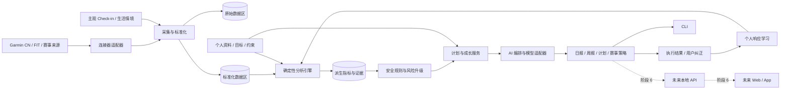

# 产品技术架构

## 1. 架构目标

产品需要同时满足七个目标：

1. **个人可用**：优先服务单个运动者，安装简单、数据本地可控。
2. **证据可追溯**：每个指标、分析和建议都能追溯到来源数据、算法版本和模型运行。
3. **连接可替换**：Garmin 中国区、国际区、文件导入或未来其他设备互不侵入核心业务。
4. **模型可替换**：OpenAI、Anthropic、Gemini、兼容 OpenAI API 的服务和本地模型通过统一接口接入。
5. **产品可发布**：源码、运行数据和内部研发过程彻底分离，可安全开源或打包商业版本。
6. **用户可控制**：用户能查看授权、限制 AI 外发、导出、备份、更正和删除自己的数据。
7. **闭环可学习**：系统同时接收客观数据、主观感受和计划执行反馈，逐步学习个人响应。

## 2. 核心架构决策

- 采用**本地优先的模块化单体**，首阶段不引入微服务。
- Python 延续现有资产，核心业务代码保持与 Garmin、数据库、Web 框架和具体 AI SDK 无关。
- 使用端口与适配器隔离外部系统，但不在 MVP 阶段建立复杂的动态插件市场。
- 训练指标由确定性算法计算；AI 负责解释、归纳、交互和计划草拟，不充当事实计算器。
- 原始数据不可变；修正和派生数据以新版本保存，不覆盖来源证据。
- 所有写回 Garmin、删除数据或安排训练的动作必须经过显式确认。
- 日常分析必须结合可选的主观 Check-in，不能把缺失的主观状态推断为“状态良好”。
- 安全规则先于 AI 建议执行；疼痛、生病或异常风险信号可以限制计划，但不能被产品表述为医学诊断。
- 数据授权、AI 外发、导出、备份、更正和删除是基础能力，不延后到商业化阶段。

## 3. 系统关系



## 4. 业务模块

### 4.1 Athlete Profile

- 基础资料、时区、单位制、运动偏好；
- 身高、体重、心率区间、阈值和健康限制；
- 可训练时间、不可训练日、场地、装备和训练环境；
- 数据授权和隐私偏好。

### 4.2 Observations

- 运动活动：跑步、骑行、游泳、力量训练和多运动；
- 身体数据：睡眠、HRV、静息心率、压力、身体电量、血氧、体重和体成分；
- 主观 Check-in：疲劳、酸痛、疼痛、情绪、训练意愿、疾病与 RPE；
- 生活情境：工作压力、旅行、时差、酒精、环境和用户选择记录的其他因素；
- 数据质量、来源、采集时间和原始记录引用。

主观记录默认由用户明确填写；系统不得把未填写解释为“无疼痛”或“恢复良好”。

### 4.3 Goals

- 运动目标：频率、里程、时长、能力或技术；
- 身体目标：体重、体成分、睡眠、恢复或健康习惯；
- 赛事目标：完赛、目标成绩、配速、功率或名次；
- 目标具有基线、目标值、截止日期、优先级、状态和检查周期；
- 支持识别目标冲突、硬约束和不同方案的取舍，不静默牺牲用户的高优先级目标。

### 4.4 Analytics

- 训练量、强度分布、连续性、单调度和负荷突增；
- 心率漂移、配速/功率表现、分段和个人最佳；
- HRV、睡眠、静息心率和身体电量的个人基线与异常；
- Fitness/Fatigue/Form、恢复状态和计划完成度；
- 数据源冲突、缺失、设备变化和异常值检测；
- 所有结论返回指标值、置信度、数据缺口、算法版本与证据引用。

### 4.5 Planning & Coaching

- 根据目标、可用时间、能力和恢复情况制定训练计划；
- 计划状态：草拟、已批准、已安排、已完成、部分完成、跳过、替代、取消；
- 计划与实际对比、未完成原因、自动调节建议和周期复盘；
- 身体调理与恢复建议；
- 饮食和补给计划；
- 赛事配速、功率、补给、装备和风险策略。

计划调整必须记录原因、依据和影响；突破用户硬约束的建议必须被拒绝，而不是仅提示。

产品只能提供训练与生活方式建议，不能替代医疗诊断。出现持续异常、疼痛或高风险信号时应建议用户寻求专业医疗意见。

### 4.6 Safety & Data Rights

- 安全信号：疼痛、疾病、异常恢复趋势、过快负荷增长和用户声明的禁忌；
- 风险动作：降低强度、暂停自动调整、建议休息或建议寻求专业帮助；
- 授权中心：数据源权限、AI 外发范围、保留期限和撤回授权；
- 用户权利：查看、更正、导出、备份、恢复和删除；
- 所有安全决策和授权变更进入审计记录。

### 4.7 Growth & Personal Learning

- 成长时间线、个人最佳、里程碑、连续性和阶段复盘；
- 记录用户是否采纳建议、执行结果和主观效果；
- 比较不同训练刺激后的个人恢复和表现响应；
- 支持受控的个人实验，但区分相关性与因果结论；
- 知识来源、分析方法和规则版本可追溯。

### 4.8 Ecosystem Connectors

- Garmin 中国区只读连接器；
- Garmin 国际区 Personal API 连接器；
- Garmin FIT/TCX/CSV 和账户导出导入器；
- 赛事目录、路线、天气和成绩来源；
- 后续可增加 Apple Health、COROS、Suunto、Strava 等连接器。

### 4.9 AI Orchestration

- 统一的 `ModelProvider` 端口；
- 能力声明：文本、结构化输出、工具调用、长上下文、视觉；
- 路由策略：隐私、成本、速度、质量和是否允许出网；
- Prompt 版本、结构化响应 Schema、重试和降级；
- 模型运行日志只记录必要元数据，默认不保存敏感原文；
- 同一份确定性分析结果可以被不同模型解释，不重复计算核心指标；
- AI 输出携带证据覆盖率、风险级别和不确定性说明；
- 用户可以纠正 AI，纠正记录进入反馈闭环而不是覆盖历史输出；
- 云端模型调用前执行数据最小化和授权检查，本地模型可作为隐私优先选项；
- 固定评测集持续检查事实一致性、安全边界和模型降级。

## 5. 已实现源码结构

产品仓使用包名 `athlete_growth`。阶段 0–5 的实际结构如下；API、Web/App 和发布系统属于阶段 6，尚未创建：

```text
athlete-growth/
├── pyproject.toml
├── README.md
├── src/athlete_growth/
│   ├── domain/
│   │   ├── athlete/
│   │   ├── goals/
│   │   ├── training/
│   │   ├── analytics/
│   │   ├── recovery/
│   │   ├── safety/
│   │   ├── growth/
│   │   ├── nutrition/
│   │   └── race/
│   ├── application/
│   │   ├── ingest/
│   │   ├── check_in/
│   │   ├── analyze/
│   │   ├── plan/
│   │   ├── learn/
│   │   ├── data_rights.py
│   │   ├── nutrition/
│   │   ├── recovery/
│   │   ├── race/
│   │   ├── ai/
│   │   └── report/
│   ├── ports/
│   │   ├── data_source.py
│   │   ├── repositories.py
│   │   ├── model_provider.py
│   │   └── workout_sink.py
│   ├── adapters/
│   │   ├── garmin_cn/
│   │   ├── files/
│   │   ├── races/
│   │   ├── storage/
│   │   └── ai/
│   └── interfaces/cli/
├── tests/
│   ├── unit/
│   ├── contract/
│   ├── integration/
│   └── fixtures/
└── docs/
    └── adr/
```

### 依赖方向

```text
interfaces → application → domain
adapters   → ports       ← application
domain 不依赖 Garmin、AI SDK、数据库或 Web 框架
```

连接器只产生标准化输入，不直接写数据库；应用层负责去重、校验、事务和同步游标。AI 只能通过应用层提供的工具读取经授权的数据。安全、授权和数据权利属于跨用例策略，但保持明确端口，不能散落成界面判断。

## 6. 数据架构

### 数据分区

1. **Raw**：来源返回的 JSON、FIT、TCX 或 CSV，按内容哈希去重且不可修改。
2. **Canonical**：统一单位、时区和字段后的活动、身体观测和目标。
3. **Derived**：基线、趋势、负荷、异常、计划完成度等可重算指标。
4. **Guidance**：训练计划、建议、报告、赛事策略和用户反馈。

### 关键实体

- `AthleteProfile`
- `AthleteConstraint`、`ConsentGrant`、`DataRetentionPolicy`
- `DataSourceAccount`、`SyncCursor`、`SourceRecord`
- `Activity`、`ActivitySample`、`Lap`、`ExerciseSet`
- `BodyObservation`、`SubjectiveCheckIn`、`ContextEvent`、`DailyRecovery`
- `Goal`、`RaceEvent`
- `TrainingPlan`、`PlannedSession`、`CompletedSession`、`PlanDecision`
- `NutritionPlan`、`RaceStrategy`
- `MetricResult`、`Recommendation`、`EvidenceRef`、`SafetySignal`
- `ModelRun`、`PromptVersion`、`UserFeedback`、`OutcomeFeedback`
- `PersonalResponseModel`、`GrowthMilestone`、`KnowledgeVersion`

每个核心实体从第一版开始携带 `athlete_id`；来源数据还需保存 `source_id`、来源记录引用、采集时间和 Schema 版本。未来多租户能力增加账户/租户归属，不改变个人训练领域模型。

### 存储策略

- MVP 使用 SQLite 作为标准化业务库，原始 FIT/JSON 保存在外部数据目录；
- Repository 端口隔离具体数据库，为未来 PostgreSQL 留出迁移能力；
- 大体量逐秒样本可以后续使用 Parquet，分析时由 DuckDB/Polars 读取；
- 数据库和原始文件均不进入产品 Git 仓库。

## 7. 运行目录和配置

源码仓之外使用独立数据目录，例如：

```text
~/.athlete-growth/
├── config.toml
├── secrets/
├── tokens/
├── profiles/
│   └── <athlete-id>/
│       ├── raw/
│       ├── db/
│       ├── derived/
│       ├── reports/
│       └── backups/
├── cache/
├── exports/
└── logs/
```

配置优先级：命令行参数 → 环境变量 → 用户配置文件 → 产品默认值。密钥和 Token 不允许写入普通配置、日志、错误报告或测试 Fixture。

## 8. 接口契约

### DataSourceConnector

- `authenticate()`：建立或刷新授权；
- `capabilities()`：声明可读数据、可写动作与时间范围；
- `sync(since, cursor)`：增量获取并返回来源记录；
- `healthcheck()`：检查授权和服务状态；
- `revoke()`：清除本地授权。

### ModelProvider

- `capabilities()`：模型能力、上下文限制和隐私属性；
- `generate(request)`：结构化生成；
- `stream(request)`：可选流式响应；
- `estimate_cost(request)`：可选成本估算；
- `healthcheck()`：验证配置。

### DataRightsService

- `list_consents()`、`grant()`、`revoke()`：管理数据源和 AI 使用授权；
- `export_profile()`：生成包含 Schema 版本的可移植包；
- `backup()`、`restore()`：验证后备份和恢复；
- `correct_record()`：追加更正而不篡改原始记录；
- `delete_profile()`：预览影响、二次确认并生成删除证明。

## 9. 安全与产品化边界

- 默认本地监听，远程访问必须鉴权；
- 敏感字段静态加密，日志脱敏；
- 外发给 AI 的字段按任务最小化，并展示数据去向；
- 健康、轨迹和身体数据按敏感个人信息处理，授权必须可查看和撤回；
- 用户可以从产品第一版开始导出、备份、恢复、更正和删除数据；
- 删除、训练写入、赛事报名等动作必须二次确认；
- 每个连接器有契约测试和速率限制；
- 商业版本不得依赖私有研发仓才能构建或运行；
- 开源样例只能使用合成或彻底匿名化数据。

## 10. 验证策略

- 单元测试：领域规则、指标计算、目标状态转换；
- 安全测试：疼痛、疾病、恢复异常和目标冲突不能被 AI 绕过；
- 契约测试：所有 Garmin/赛事/AI 适配器必须满足统一端口；
- 集成测试：使用脱敏 Fixture 验证同步、去重和数据库迁移；
- 数据权利测试：导出可恢复、撤回授权立即生效、删除不遗留孤儿数据；
- Golden tests：固定输入对应固定训练指标和报告结构；
- AI 评测：事实一致性、证据引用、结构化输出、用户纠正、风险建议和模型降级；
- 回归测试：现有 783 条历史活动提取和 127 条 FIT→TCX 转换流程不得破坏。
