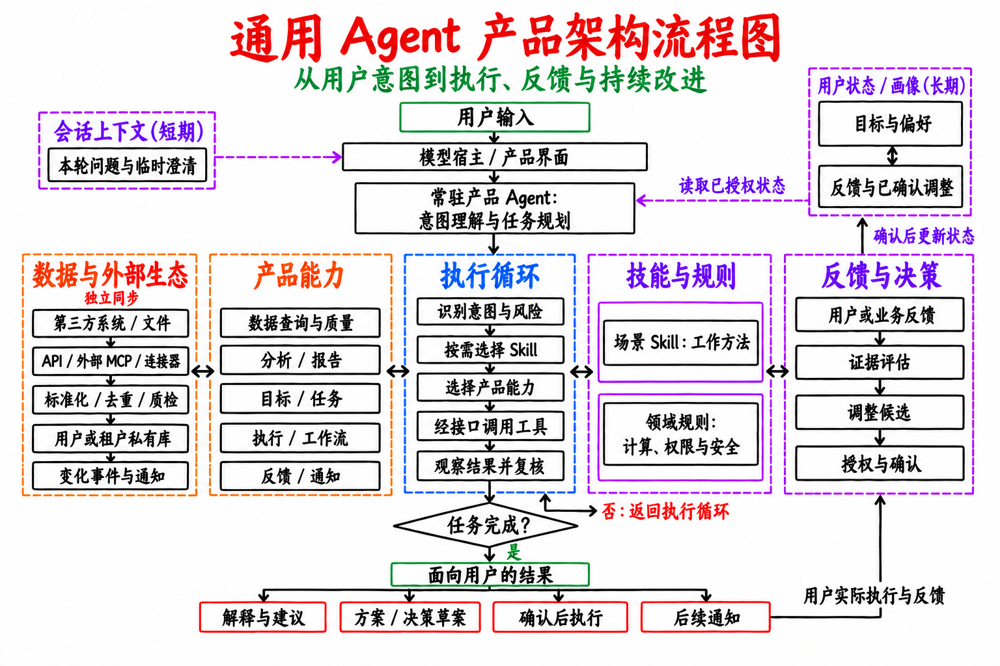
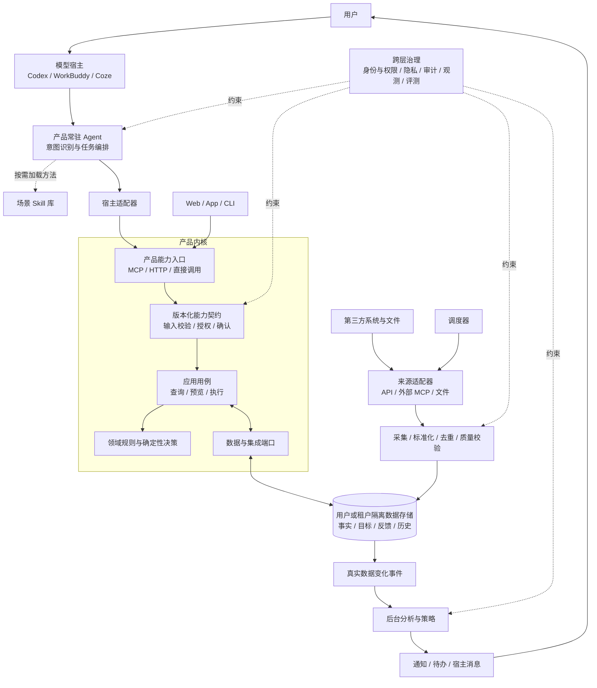

# 可复用的 Agent 产品架构蓝图

这张图从本项目提取通用结构，适用于以对话为入口、连接外部数据、保存用户状态并提供领域决策的产品。它是架构模板，不代表其他项目已经具备这些能力。

- [下载白底 PNG](images/generic-agent-product-architecture.png)
- [打开可编辑 SVG](images/generic-agent-product-architecture.svg)

五栏从左到右是**数据与外部生态、产品能力、执行循环、技能与规则、反馈与决策**。画像、能力名称、规则和确认条件都由具体领域定义；不需要长期个性化的项目可以把右上角的用户状态简化为已授权的业务上下文。数据同步可独立于对话运行。

## 技术实现视图

## 四条路径

1. **对话执行**：Agent 每轮理解意图；场景 Skill 按需提供方法；宿主适配器通过产品 MCP、HTTP 或直接调用进入同一套能力契约和应用用例。简单查询不必加载 Skill。Web、App、CLI 也可复用应用用例。
2. **数据进入**：外部 API、外部 MCP 或文件是来源适配方式；采集后标准化、去重并写入隔离的数据存储。产品 MCP 位于对话入口侧，与来源适配器职责不同。
3. **自动闭环**：调度器同步外部变化；真实变化触发分析、策略和通知，不依赖用户正在对话或模型持续运行。
4. **反馈与决策闭环**：反馈决策与场景 Skill、领域规则分开，使用执行结果和适用规则评估证据，提出有范围的调整候选；按领域授权或确认策略更新用户状态，下一轮 Agent 再读取。Agent/Skill 的产品版本升级属于独立的研发与评测流程。

## 复用与替换

| 可复用的骨架 | 每个项目需要替换或重新验证的内容 |
|---|---|
| 常驻 Agent、按需 Skill、宿主适配、版本化工具契约 | 角色定位、意图分类、场景方法、工具语义与宿主行为评测 |
| 应用用例、领域规则、端口与适配器的依赖方向 | 领域对象、决策算法、安全边界、授权与确认策略 |
| 私有状态、来源采集、标准化、变化事件、后台通知 | 数据模型、外部连接器、去重身份、同步频率、保留和删除规则 |
| 日志、审计、合成测试和跨宿主验收 | 领域正确性指标、风险场景和真实环境验收条件 |

本项目可直接复用这套**分层方式和接口原则**。Garmin 连接、训练安全规则、负荷计算、目标计划算法和个人响应门槛属于运动领域实现，迁往别的项目时应重新设计。用户数据、凭据与模型密钥始终保存在对应项目的私有运行环境，不放进可复用模板。

当前实现与交付状态见 [产品技术架构](architecture.md)和[产品路线图](roadmap.md)。
