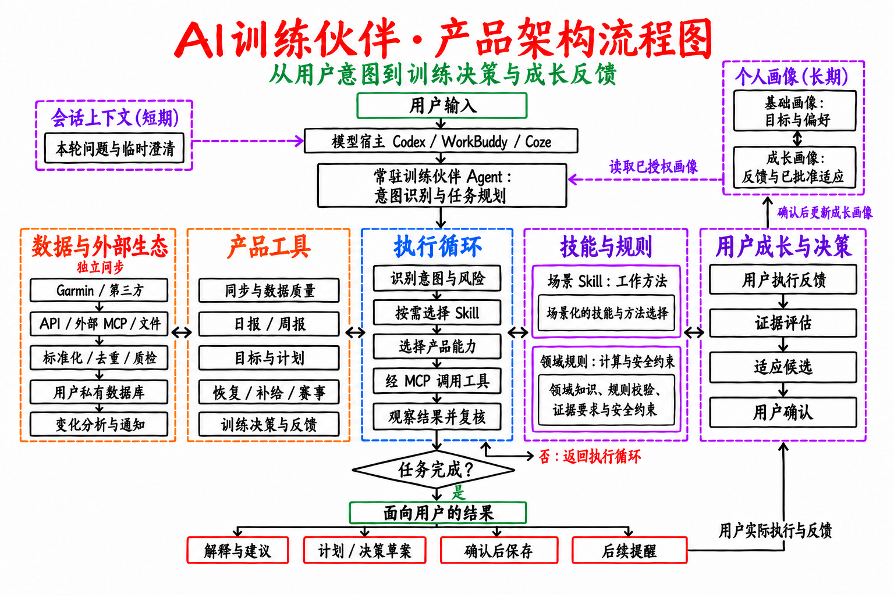

# AI Trimate：白底手绘风格架构流程图

- [下载白底 PNG](images/training-partner-whiteboard-v10.png)
- [打开可编辑 SVG](images/training-partner-whiteboard-v10.svg)：文字、方框、箭头和颜色都是独立矢量元素，可在 SVG 编辑器中修改。

图中上方是用户输入、模型宿主和常驻 Agent；中间依次为**数据与外部生态、产品工具、执行循环、技能与规则、用户成长与决策**五栏；下方是任务完成判断和面向用户的结果。数据与外部生态虽与产品工具并排展示，仍独立于对话执行同步。产品 MCP 是模型宿主调用本产品能力的接口，外部 MCP 是第三方数据来源的可选连接方式。Skill 是按需加载的方法；产品安全规则、确认和持久化由应用用例执行。Codex 已有项目入口；WorkBuddy、Coze 仍是目标宿主，接入状态以[路线图](roadmap.md)为准。

箭头明确表示：Agent **读取已授权个人画像**后进入执行循环；执行循环把结果送入**任务完成？**判断，未完成则返回循环继续查询或澄清，完成才生成用户结果。用户实际执行后的反馈进入右侧成长决策，经确认的适应再更新成长画像。画像读取、成长更新和任务循环是三条不同的关系。

**技能与规则**位于执行循环右侧，包含场景 Skill 的工作方法和领域计算、安全约束。**用户成长与决策**作为独立区域紧邻其右：用户实际执行后，完成情况、主观感受和设备记录进入反馈；产品校验证据、提出有边界的适应候选；用户确认后才更新私有成长画像，供下一轮 Agent 读取。两块区域相互协作，但各有职责。个人画像是私有数据的有来源投影，其中成长画像描述训练变化与个人反应；短期会话上下文单独存在。当前实现只会在特定条件下把低风险日的默认建议调得更保守；Agent、Skill 和安全规则不会因单个用户的反馈自行改写。[决策边界](adr/0011-evidence-bound-growth-decisions.md)

图中的“产品工具”是可调用的能力，例如查询报告、预览计划和保存已确认决策；“场景 Skill”是完成一类任务的方法；“领域规则”是应用用例执行时必须满足的计算和安全约束。三者各有职责。架构图使用可扩展的“场景 Skill”标签，当前具体 Skill 清单由版本化的 `experience/manifest.json` 管理。

更简洁、跨领域的骨架见[可复用架构蓝图](reusable-agent-product-architecture.md)。
